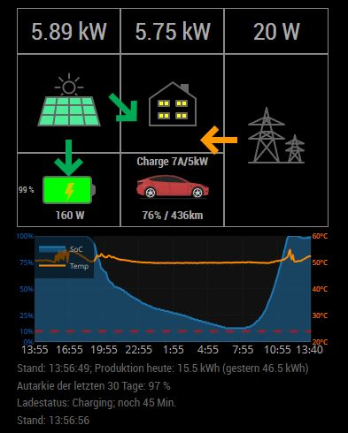

# MMM-PVMonitor
Show SolarEdge Inverter data on your Magic Mirror

## Configuration
- siteId: Enter the site ID from the SolarEdge monitoring portal
- ~~apiKey: Enter the apiKey generated in the SolarEdge monitoring portal~~ (Solaredge monitoring API uses OAuth2)
- accessToken: Enter the access token retrieved as described [in the Developer Platform Docs](https://api-docs.solaredge.com/docs/developer-platform/df8kx5j4z9vi0-homeowner-and-self-access-guide#3-run-oauth-against-your-own-account)
- refreshToken: Refresh token to get a new accessToken if the old one expires
- clientId: Client ID set up in the SolarEdge developer portal for your application
- clientSecret: Client Secret set up in the SolarEdge developer portal for your application
- interval: Interval (in ms) between power flow updates, default 30 minutes. The free tier of the API allows 2000 requests per month and a power flow update costs 2 requests, so plan accordingly
- activeFrom / activeUntil: Time window ("HH:MM") in which power flow updates are made, default 06:00 - 21:30. No updates are made outside of it
- Production and autarchy are fetched once a day at 00:10

The current tokens are stored in `tokens.json` (access and refresh tokens are renewed automatically). If you put a new refreshToken into config.js, it replaces the stored tokens.

Add these to your MagicMirror's config.js.